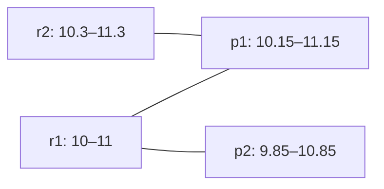

# 三分钟演示与讲解草案

状态：供后续实现的演示脚本，**尚未运行**。示例算式由AI整理，须由参赛者本人复算/讲解后再记录其完成状态；不能写成“用户已手算”。

## 0:00–0:40：重复预测为什么不能双计TP

展示 examples/duplicate.json：参考r1=[10,12]；预测p1=[10,12]、p2=[10.05,12.05]。c=0.2、q=0.5；两预测均合格，但同一参考只能使用一次，因此TP=1、FP=1、FN=0，P=1/2、R=1、F1=2/3。

待实现命令：`mooneventeval evaluate examples/duplicate.json --format text`。现场先说明容差由调用者声明，不代表算法自动挑选最佳评分规则。

## 0:40–1:40：贪心为什么少算，增广如何纠正

参考r1=[10,11]、r2=[10.3,11.3]；预测p1=[10.15,11.15]、p2=[9.85,10.85]。起点差分别为0.15、0.15、0.15、0.45；默认起点容差0.2。前三条边存在，r2-p2不合格。

按r1-p1先到先配只得到1对；沿r2→p1→r1→p2调整，得到r1-p2、r2-p1两对。最大TP为2，因为参考只有2个且已有覆盖两者的合法匹配。

**参考预期：**sed_eval固定版本的optimal模式也应得到TP=2；这是源码/数学推导，尚未实跑。这里的卖点是比朴素贪心可靠的MoonBit实现与解释，不把与sed_eval一致包装成超越它。若实跑不同，先排查配置、浮点与输入，不把差异自动当优势。

## 1:40–2:30：边界与解释

参考[10,12]；分别独立评测预测[10.2,12.2]与[10.200001,12.2]。起点差0.2包含等号，超过1微秒则不合格。终点容差max(0.2,2×0.5)=1秒，两例终点均合格。

待实现命令：`mooneventeval explain-pair examples/boundary.json --recording clip-01 --reference r1 --prediction p1 --format text`。解释合格不等于进入某个最大匹配；多最优解的配对身份由固定实现规则选择。

## 2:30–3:00：主动说明边界

讲明：用户提供参考标注；首版不检测信号、不做临床判断；不同类别不配对；空分母为未定义；资源耗尽明确失败。出示真实运行SHA/命令/输出与独立验证范围，不只放测试数量。

验收演示时记录：实际命令、退出码、原始输出、参赛者能否独立说明三处算式与一个取舍；还未发生的演示和本人讲解保持未完成。
