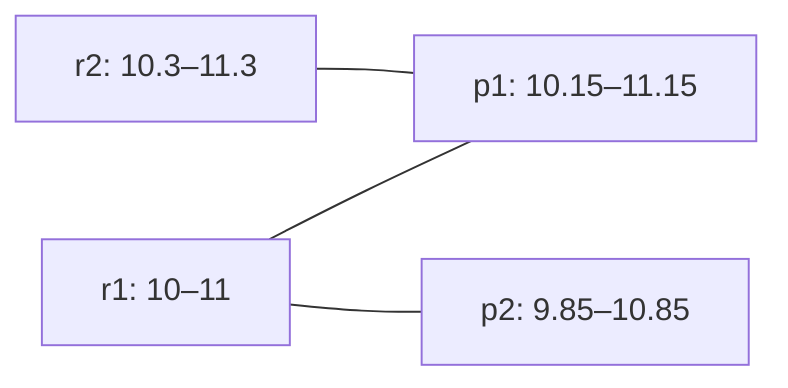

# 三分钟演示与讲解稿

这是可复跑的合成数据演示脚本。自动运行记录不等于本人讲解；**本人复算、口头讲解和M2仍未完成**。目标仅已验证本机macOS arm64 native，参考原版历史证据见[阶段结果](reviews/2026-10-20-t1b-results.md)。

先构建，再在仓库根目录执行；每次输出用新目录：

```sh
scripts/with-toolchain.sh moon build cmd/mooneventeval --target native --release --deny-warn
python3 scripts/demo.py --bin _build/native/release/build/cmd/mooneventeval/mooneventeval.exe --output evidence/T5/demo-recheck
```

下面用`MEE`代指上述exe的路径；它是直接运行的本地产物，不是moon run。输入只读，不覆盖文件。

## 0:00—0:45 重复预测为什么是FP

```sh
_build/native/release/build/cmd/mooneventeval/mooneventeval.exe evaluate examples/duplicate.json --format text
_build/native/release/build/cmd/mooneventeval/mooneventeval.exe explain-pair examples/duplicate.json --recording clip-01 --reference r1 --prediction p2 --format text
```

一个参考、两个重复预测：TP1/FP1/FN0。p2本身满足时间条件，但一对一配对已选p1；“有候选但未选中”不等于“时间不合格”。explain-pair只解释这两个事件的资格，不运行最大匹配，也不声称这对已选中。

## 0:45—1:50 贪心陷阱与增广路径

```sh
_build/native/release/build/cmd/mooneventeval/mooneventeval.exe evaluate examples/greedy-trap.json --format json
```

同类alarm、collar=0.2秒。r1起点10、r2起点10.3；p1起点10.15、p2起点9.85；各自长度1秒，终点容差max(0.2,1×0.5)=0.5秒。起点差绝对值分别为0.15、0.15、0.15、0.45，因此只有下列三条边：



不可回退的朴素贪心先取r1→p1，会让r2无处可配，只得TP1。沿r2→p1→r1→p2增广，改为r2→p1、r1→p2，得TP2。产品先找空闲预测，必要时用显式栈DFS增广，最大化配对数；不最小化时间误差。同版本规范ID排序固定选择，工作量跨所有分组共享20M预算，超限整任务失败。

**锁定sed_eval的optimal模式在本例预期也是TP2，T1b已实测。**这个例子展示最大匹配相对朴素贪心的必要性，不虚构超过成熟评测工具的成绩。

## 1:50—2:35 精确边界与可解释性

```sh
_build/native/release/build/cmd/mooneventeval/mooneventeval.exe explain-pair examples/boundary.json --recording clip-01 --reference r1 --prediction p1 --format text
```

10.2−10=0.2，起点等号通过。十进制秒字符串先精确转Int64微秒；参考时长与比例交叉乘法比较，终点有效阈值可显示到十二位秒，不用epsilon。偏差保留预测减参考的符号。该例eligible=true不需要匹配身份推断。

## 2:35—3:00 失败协议与取舍

```sh
_build/native/release/build/cmd/mooneventeval/mooneventeval.exe evaluate examples/missing.json --format json
```

真实缺文件exit2、status=failed、FILE_ERROR，无summary或部分分数。完成但零TP/事件对不合格仍exit0；资源超限exit3，内部非预期故障exit4。默认文本；机器JSON失败写stdout，文本诊断写stderr。只支持UTF8 JSON/字符串时间，重名键后值覆盖是已披露限制；TSV仍待批准。读取最多8MiB+1、仅普通文件（允许普通文件符号链接），输出失败可能已有前缀，无法撤回，但必须非零。

本人实际演示后另记日期、被演示SHA、亲手推导和可回答的问题；本稿及自动收据不替代该记录。
