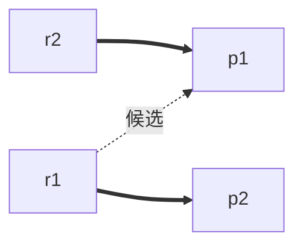

# 三分钟演示与算法说明

这是项目负责人的演示准备材料，不是已完成答辩/本人录屏的证明。先完成根README的锁定工具链安装与native构建，不需要Python参考环境。

## 0:00–0:30：说明输入和实际交付

已有参考标注与预测，字段是录制、类别、起点和终点。MoonEventEval不是检测模型，而是MoonBit评测库和文件CLI。运行：

```sh
_build/native/release/build/cmd/mooneventeval/mooneventeval.exe evaluate examples/duplicate.json --format json
```

展示summary和false_positives：一条参考、两条合格预测，TP1/FP1/FN0。JSON可保存供外部脚本处理，库调用不依赖Python。

## 0:30–1:20：解释最大匹配

```sh
_build/native/release/build/cmd/mooneventeval/mooneventeval.exe evaluate examples/greedy-trap.json --format json
```

r1能配p1/p2，r2只能配p1。若停在r1-p1，就会漏掉一个合法对应。通过增广路径将r1改配p2，得到两对。图中粗线是最终选中边。



配对最大化TP数量，不最小化时间误差；同录制、同类别才能连边，ID顺序固定遍历。上游sed_eval optimal也能得到TP2，不能把这个例子宣传成优于上游。

## 1:20–2:20：公开标注接入和错误定位

```sh
python3 demo/public-data/reproduce.py --check --output /tmp/mooneventeval-presentation
```

选择一个新空目录。参考来自有来源和CC BY4.0归属的DESED公开标注；预测为三项受控改动，不是实际模型成绩。展示baseline.json的11/0/0、regressed.json的9/2/2及analysis.md。打开explain-shift.json，说明0.201秒超过0.2；再打开explain-duplicate.json，说明eligible=true仅为候选资格，不表示选中。

## 2:20–3:00：说明精确时间、安装与边界

时间按十进制字符串解析为Int64微秒，比例用整数，比较不加epsilon。参考10.1与预测10.3差0.2，等号合格；超过1微秒就可能改变资格。终点容差为max(collar,参考时长×比例)。

正式库安装：`moon add z2823253773-p/mooneventeval@0.1.0`，导入z2823253773-p/mooneventeval/eventeval。MIT源代码、公开历史、参考范围与数据许可均可查。native仅验证macOS arm64/Linux x86_64；输入/资源错误非零退出、不返回部分分数。20M匹配工作预算可能拒绝高复杂度合法任务，指标空分母为null。

## 常见追问

- **与sed_eval的关系？** 参考EventBasedMetrics的起止点容差和optimal匹配规则，MoonBit独立实现；不是全量移植，分段指标、substitution错误率和完整DCASE协议未实现。整数与binary64在特定边界可不同，已单列见证。
- **为什么TSV还要导入为JSON？** 严格四列TSV解决已有事件表接入；统一任务模型使评测、解释、API共享规则，避免两套评分实现。
- **有什么证据？** 当前验收入口见FINAL_ACCEPTANCE.md。单元、原版限定对照、公开数据、包外源码消费者与注册表安装分别列证据，互不冒充。
- **为什么不用网页/训练模型？** 本次交付目标是可安装的评测基础组件；不扩大未经申报和验证的产品范围。
