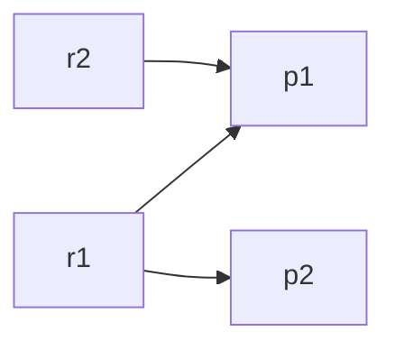

# T3 八组可复算例题

这些是agent编写、可用源码/JSON复跑的推导，不是用户本人已经纸笔复算或能独立讲解的证据。本人复算/讲解仍是M2/demo未完成项。事件单位为秒；除E7外，默认c=0.2、q=0.5。先判边，再求一对一最大基数；F1=2TP/(参考数+预测数)，零分母为null。

| 例题 | 独立推导 | 计数/指标 | 实际输入入口（evidence/T3/parity/下） |
| --- | --- | --- | --- |
| E1 重复预测 | r=[10,12]；p1=[10,12]、p2=[10.05,12.05]都合格。只有一个参考，不能有两条同时选中的边 | TP1/FP1/FN0；P=1/2,R=1,F1=2/3；固定次序选p1，p2仍有候选 | duplicate/input.json |
| E2 增广陷阱 | r1=[10,11]连p1=[10.15,11.15]及p2=[9.85,10.85]；r2=[10.3,11.3]只连p1（与p2起点差0.45）。r1-p1的局部选择须移动为r1-p2，再配r2-p1 | TP2/FP0/FN0；P=R=F1=1 | greedy-trap/input.json |
| E3 起点等号 | r=[10,12]，p=[10.2,12.2]；起点差0.2等于c，终点差0.2≤max(0.2,2×0.5)=1。将p起点改10.200001，单独重测，超出1us | 等号TP1/F1=1；超出TP0/FP1/FN1/F1=0 | boundary/及E3-onset-outside/input.json |
| E4 终点等号 | r=[10,12]；p=[10,13]差1，恰等于参考时长2×0.5。改13.000001后差1.000001>1 | 等号TP1；超出TP0/FP1/FN1 | E4-offset-equal/及E4-offset-outside/input.json |
| E5 collar主导 | r=[0,0.1]；p=[0.2,0.3]；起终点差均0.2，终点阈值max(0.2,0.1×0.5)=0.2；改成min会错误拒绝。区间并不相交，规则未要求相交 | TP1/FP0/FN0；P=R=F1=1 | E5-collar-dominates/input.json |
| E6 参考时长 | r=[10,12]；p=[10,11]；终点差−1，比较绝对值1，参考时长阈值2×0.5=1。误用预测时长会变0.5而错误拒绝 | TP1；offset_delta_s=-1，offset_limit_s=1 | E6-reference-duration/input.json |
| E7 分数微秒 | c=0、q=0.5；r=[10,10.000003]时长3us，阈值1.5us。p终点10.000004差1us合格；10.000005差2us不合格，不能把阈值舍入为整数微秒 | 两次分别TP1/TP0；报告阈值0.0000015；原版sed_eval拒绝0 collar，不能计作参考TP0或伪称parity | E7-fractional-microsecond/及E7-fractional-outside/input.json |
| E8 录制隔离 | x只有r=[1,2]，y只有p=[1,2]；时间类别虽相同，跨录制不建边。两录制都必须纳入汇总 | TP0/FP1/FN1；P=R=F1=0 | recording-isolation/input.json |

可用于讲解的E2图：

“先找空闲预测”只是快速路径；r2找不到空闲点后必须沿p1的拥有者r1继续DFS，到空闲p2后逆写整条路径。若直接停在r1-p1，会把TP少算成1。算法只保证最大基数，不最小化时间误差；多最优解下固定索引次序决定所选身份。

额外数值见证：decimal-onset-binary64-flip中r起点10.1、p起点10.3，十进制差精确0.2；binary64差为0.20000000000000107>0.2，原版TP0，产品/有理数TP1。完整原版输出及hex浮点见证已保留；不加epsilon，不删除这个反例。跨类别案例另外保留raw Nsubs和projected FP/FN，不能将projection说成原始全局结果完全一致。
